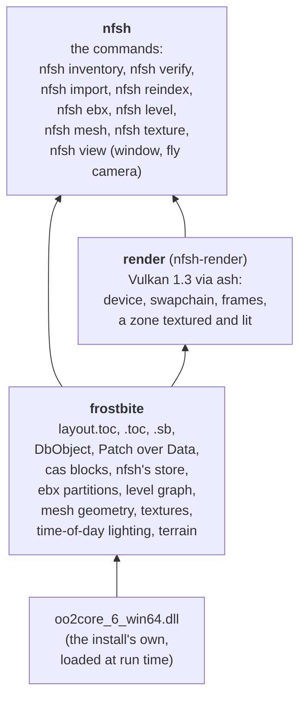
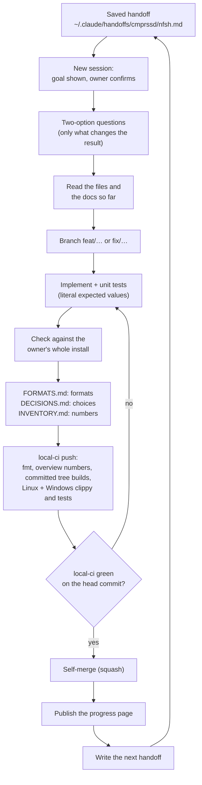
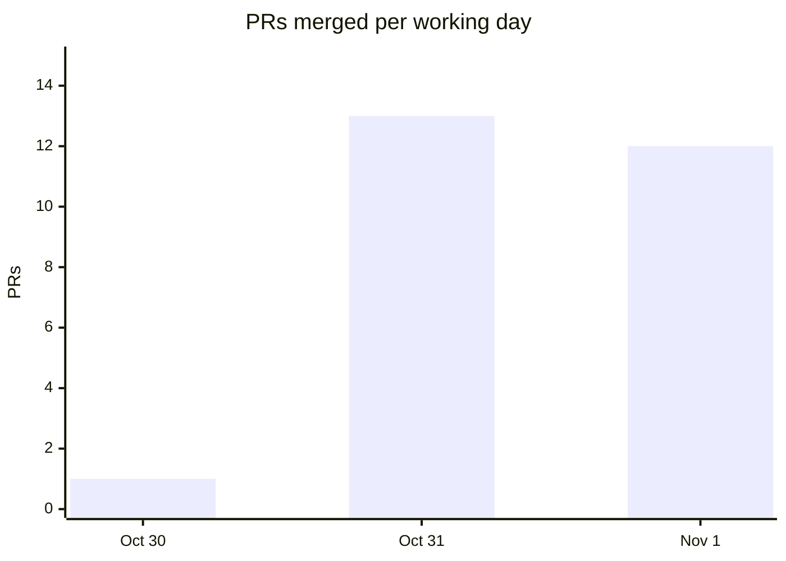

# How nfsh works

A guided tour of the project: what it builds, how the code is laid out, how each step is
checked against the original game's files, and how the work itself is run.
[DECISIONS.md](DECISIONS.md) holds every choice with its reason,
[FORMATS.md](FORMATS.md) the file formats as we read them, and
[INVENTORY.md](INVENTORY.md) what the owner's install holds. The same numbers, as
charts, are on the [progress page](#progress-page).

<!-- progress:asof -->
Numbers in the generated parts below are as of 2026-11-01 (26 merged PRs), counted by
`scripts/progress.py`.
<!-- /progress -->
The hand-written parts give their own dates.

## What it is

nfsh is a new engine for **Need for Speed: Heat** (Ghost Games / EA, 2019), written in
Rust with Vulkan 1.3 (`ash`). It reads the player's own Steam install (`Data/` and
`Patch/`) and aims to show the same game with the same look, while taking much less disk
space, running much faster and never crashing.

It is written **clean-room**. Heat's code was never released, so unlike swjkja (whose
reference is the original's published source) there is no code to read: file formats
and behaviour are worked out from the files themselves and from watching the game run.
The repository is public and holds only our own descriptions and code; no game data, no
EA code, nothing decompiled.

## The idea in one picture

Every reader is proven against the whole install, not a sample: a test opens the owner's
copy and reads every file of its kind. What is learned goes into FORMATS.md, and the
inventory turns it into numbers that decide what to build next.

Once something renders, the loop gains swjkja's second half: the original game and nfsh
draw the same camera path on the same PC, and screenshots and frame times are compared
(`docs/BASELINE.md`, not started yet).

## Architecture

<!-- progress:code -->
3 crates in one Cargo workspace, 17,159 lines of Rust (sources and tests), 142 tests.
<!-- /progress -->

<!-- progress:crates -->
| Crate | Rust lines | Tests | What it does |
|------|------:|------:|------|
| `frostbite` | 10,539 | 94 | readers for the install's tables: `layout.toc`, superbundle `.toc` and `.sb`, DbObject trees, cas references; resolves `Patch/` over `Data/`; decompresses entries (Oodle through the install's own library); writes, checks and reads nfsh's store, with every ebx's partition GUID; reads ebx partitions (types, instances, fields, arrays, references); walks a level's sub-levels and what each zone places (meshes in world space); reads mesh sets and decodes their geometry (LODs, sections, positions, texture coordinates, tangent frames, triangles); reads texture headers and their pixels (block-compressed mips, layers), and what each material names (its shader, textures and vector parameters); reads a time of day's sun, sky and exposure from its visual environment; reads the terrain's quadtree of tiles, their heightfields, colours and pages, and builds the ground's mesh under an area, coloured and weighted by its layers, with a map of the same colour and weights for what lies over it; reads the terrain's layer tree (which layers each tile's pages are for), the level's shader database (each shader permutation's parameter block, the textures it binds and its program) and so each terrain layer's own diffuse maps; reads a shader program's instructions far enough to find the scale each terrain layer's diffuse is drawn at; averages a BC1 texture's colour |
| `nfsh` | 2,254 | 15 | the `nfsh` command: `inventory` lists what the install holds, `verify` decompresses every entry and checks its size, `import` copies the live data into nfsh's store, `reindex` lists its partition GUIDs, `ebx` prints a partition as text, `level` prints Palm City's bundles or one zone's placements, `mesh` prints a mesh's LODs and writes one as an .obj, `texture` prints a texture and writes it as a .dds, `view` flies through one zone in a window, textured and lit at midday or tealnight (or writes a screenshot) |
| `render` | 4,366 | 33 | the Vulkan renderer (`nfsh-render`, Vulkan 1.3 through `ash`): device bring-up, a window's swapchain and frame loop with GPU timing, an offscreen target read back for screenshots and tests; packs a zone's placed meshes (first LOD) into one vertex, index and instance buffer and draws them with one instanced draw per section, each with its colour texture uploaded block-compressed as stored (grey when one can't be read), road asphalt as its clean and damaged layers blended by the road's mask with its detail colours over them, giving way to the ground at its edges as its shoulder texture says (up to seven textures a draw, and the ground's map of its colour and detail weights) and road lines, cracks and tyre marks blended over it as decals, lit by the time of day's sun and sky, exposed and tonemapped, with each mesh's own normals (the triangle's where it has none); the ground under the zone as one more draw, in its tiles' colours with up to eight of its layers' diffuse maps (one texture array) laid over them as detail, weighted by each layer's share of the tiles' pages |
<!-- /progress -->

Every reader checks bounds and returns an error on malformed input, so a damaged or
unexpected file is reported, never a crash. The tests that read the real install and
the store run on the Windows side, where local-ci passes `NFSH_INSTALL` and `NFSH_STORE`;
the store tests read every value of all 725,119 ebx partitions and walk all 232 zones of
Palm City (259,999 placed meshes, every reference resolved), then read the geometry of
every mesh placed there (5,475 meshes, 48.8 million triangles in all their LODs) and
every texture their materials name (8,015 textures, 4.7 GiB of pixels). The renderer's
tests draw on the real device (lavapipe on Linux, the GPU on Windows) and read the pixels
back; a store test builds zone 495 (the speedway: 2,171 placements of 199 meshes, 780
sections with 129 textures, 4.0 million triangles), every mesh drawn.

## The process

The owner steers; Claude (Claude Code) does the engineering, one task per session.

Rules that shape it:

- **Two-option questions.** Before building, Claude asks the owner only what changes the
  result, with a recommendation. Choices that come up mid-build are made by Claude,
  marked *decided by Claude, pending review* in DECISIONS.md, and listed in the PR.
  <!-- progress:process -->
  So far: 29 decision entries, 10 chosen by the owner, 17 made by Claude for review.
  <!-- /progress -->
- **$0 development.** No GitHub Actions: `.local-ci` runs on this machine (format, shell
  and Python syntax, this overview's numbers, a build of exactly the committed tree, then
  clippy and tests on Linux/WSL and on Windows/MSVC in parallel) and posts a `local-ci`
  status to the PR. A PR merges only when that status is green on its head commit.
- **No game data in the repository.** A whitelist `.gitignore` admits only the kinds of
  files the project writes, so a `.toc` or `.cas` cannot be committed by accident.
- **The numbers are counted, not typed.** The generated parts of this page come from
  `scripts/progress.py`, and local-ci fails when they are stale.
- **Short sessions, saved handoffs.** Each session ends with a self-contained prompt for
  the next one, so context is rebuilt from the docs, not from a long chat.

## Statistics

### History

<!-- progress:history -->
27 commits, 26 merged PRs from 2026-10-30 to 2026-11-01, on 3 working days: 21 feat, 4
docs, 1 ci. About 24,514 lines added and 1,256 removed; 61 tracked files.

<!-- /progress -->

### The install, read

<!-- progress:install -->
Measured by `nfsh inventory` on 2026-10-30 ([INVENTORY.md](INVENTORY.md)):

| What | Count | Size |
|------|------:|------:|
| Files in the install | 392 | 34.45 GiB |
| cas archives (stored asset bytes) | | 33.15 GiB |
| ... still read after the patch | | 29.28 GiB (88.3%) |
| ... replaced by the patch, dead | | 3.87 GiB |
| Superbundles, bundles | 22, 20,739 | |
| Ebx, res, chunk references | 725,215, 260,398, 411,889 | |
| ... distinct | 221,745, 108,281, 242,640 | |
<!-- /progress -->

What it means: almost all of the 34 GiB is cas archives, so "smaller" is decided by how
the archived data is stored, and dropping the dead data alone is a free first saving
that nfsh's own format has to beat. Palm City is
`Win32/levels/mainlevel/mainlevel`, confirmed by reading its root partition: 232
streaming zones, each with four lighting variants (midday, overcast, sunset,
tealnight). Details in [INVENTORY.md](INVENTORY.md) and [FORMATS.md](FORMATS.md).

### The store

`nfsh import` writes the 1,317,687 distinct entries the patched tables use into nfsh's
store, each recompressed from Heat's Oodle blocks into one zstd frame (level 19, the
ebx with a dictionary), and checks every entry against the install. Measured on the
owner's install, 2026-10-31:

| Store | Packs | Index | Total | Import |
|-------|------:|------:|------:|-------:|
| cas archives (the install) | | | 33.15 GiB | |
| 0.3.0: live entries copied, Oodle blocks kept | 30, 29.35 GiB | 148 MiB | 29.49 GiB | 27 min |
| **0.4.0: recompressed with zstd** | 29, 27.92 GiB | 148 MiB | **28.07 GiB** | 117 min |

zstd ends up 4.8% smaller than Oodle (the sample predicted about the same size) and
makes the store readable anywhere: `nfsh verify` decodes all 65.4 GiB from it in 5
minutes with no game files. How the level was chosen, with the sample measured, is in
[DECISIONS.md](DECISIONS.md). The 0.3.0 packs were about 70 MiB above the 29.28 GiB of
live bytes because some distinct entries overlap in the archives; each is still stored
whole.

## Where it is going

From [BRIEF.md](BRIEF.md) and [DECISIONS.md](DECISIONS.md) (2026-10-31):

| # | Milestone | State |
|---|------|------|
| 1 | Data inventory: read the install's tables | done (0.1.0) |
| 2 | Read entry contents: decompress the cas blocks | done (0.2.0) |
| 3 | Import step: nfsh's own compact copy of the data | done (0.3.0: dead data dropped; 0.4.0: zstd) |
| 4 | Palm City viewer: fly-through, frame time, day/night | started: ebx reader (0.5.0); level graph, every zone's placed meshes (0.6.0); mesh geometry (0.7.0); textures (0.8.0); a window flying through one zone, untextured (0.9.0); textured and lit, midday and tealnight (0.10.0); the roads under it (0.11.0); the terrain (0.12.0); road materials (0.13.0); the terrain's colours (0.14.0); the ground's detail (0.15.0); the asphalt's layers (0.16.0); the roads' edges (0.17.0); the meshes' own normals (0.18.0) |
| 5 | Baseline against the original: same camera path, same PC, screenshots | not started |
| 6 | One drivable car, then races, police, campaign | later |

## Progress page

The [progress page](https://cmprssd.github.io/nfsh/) tells the same story as charts: PRs
per day, Rust lines and tests after every PR, the crates, and what the install holds. It
is served from the `gh-pages` branch, which holds the page alone, so main stays free of
anything generated. `scripts/publish-progress.sh` builds it from
`scripts/progress.py --json` and `scripts/progress_page.html` and publishes it after
each merge (see CLAUDE.md). It shows no game imagery yet; when the viewer renders, the
before-and-after comparisons arrive as in swjkja, still only on `gh-pages`.

## Reproducing the numbers

    cargo test --workspace                                        # Linux
    NFSH_INSTALL='D:\…\Need for Speed Heat' NFSH_STORE='D:\nfsh-store' \
        WSLENV=NFSH_INSTALL:NFSH_STORE \
        scripts/cargo-msvc.sh test --workspace                    # Windows, install and store
    cargo run --release -- inventory "<install>" > out.md         # INVENTORY.md
    python3 scripts/progress.py                                   # this page's numbers
