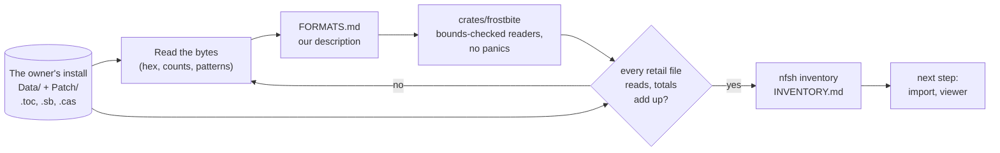
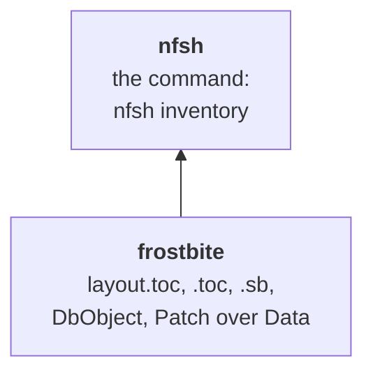
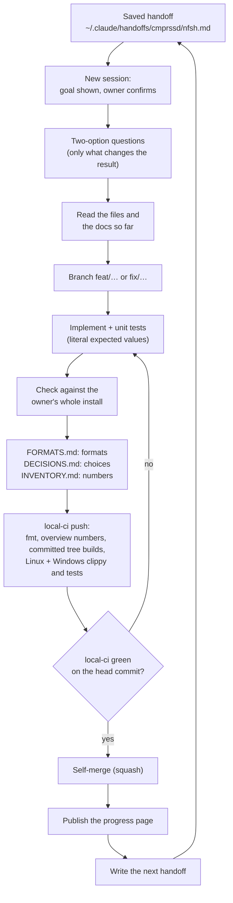
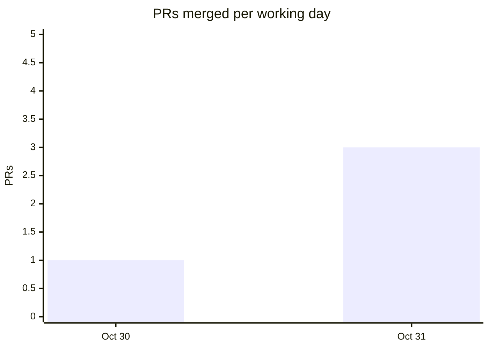

# How nfsh works

A guided tour of the project: what it builds, how the code is laid out, how each step is
checked against the original game's files, and how the work itself is run.
[DECISIONS.md](DECISIONS.md) holds every choice with its reason,
[FORMATS.md](FORMATS.md) the file formats as we read them, and
[INVENTORY.md](INVENTORY.md) what the owner's install holds. The same numbers, as
charts, are on the [progress page](#progress-page).

<!-- progress:asof -->
Numbers in the generated parts below are as of 2026-10-31 (4 merged PRs), counted by
`scripts/progress.py`.
<!-- /progress -->
The hand-written parts give their own dates.

## What it is

nfsh is a new engine for **Need for Speed: Heat** (Ghost Games / EA, 2019), written in
Rust with Vulkan 1.3 (`ash`). It reads the player's own Steam install (`Data/` and
`Patch/`) and aims to show the same game with the same look, while taking much less disk
space, running much faster and never crashing.

It is written **clean-room**. Heat's code was never released, so unlike swjkja (whose
reference is the original's published source) there is no code to read: file formats
and behaviour are worked out from the files themselves and from watching the game run.
The repository is public and holds only our own descriptions and code; no game data, no
EA code, nothing decompiled.

## The idea in one picture

Every reader is proven against the whole install, not a sample: a test opens the owner's
copy and reads every file of its kind. What is learned goes into FORMATS.md, and the
inventory turns it into numbers that decide what to build next.

Once something renders, the loop gains swjkja's second half: the original game and nfsh
draw the same camera path on the same PC, and screenshots and frame times are compared
(`docs/BASELINE.md`, not started yet).

## Architecture

<!-- progress:code -->
2 crates in one Cargo workspace, 1,765 lines of Rust (sources and tests), 19 tests.
<!-- /progress -->

<!-- progress:crates -->
| Crate | Rust lines | Tests | What it does |
|------|------:|------:|------|
| `frostbite` | 1,183 | 15 | readers for the install's tables: `layout.toc`, superbundle `.toc` and `.sb`, DbObject trees, cas references; resolves `Patch/` over `Data/` |
| `nfsh` | 582 | 4 | the `nfsh` command; for now `inventory`, which lists what the install holds |
<!-- /progress -->

Every reader checks bounds and returns an error on malformed input, so a damaged or
unexpected file is reported, never a crash. The test that reads the real install runs
on the Windows side, where local-ci passes `NFSH_INSTALL`.

## The process

The owner steers; Claude (Claude Code) does the engineering, one task per session.

Rules that shape it:

- **Two-option questions.** Before building, Claude asks the owner only what changes the
  result, with a recommendation. Choices that come up mid-build are made by Claude,
  marked *decided by Claude, pending review* in DECISIONS.md, and listed in the PR.
  <!-- progress:process -->
  So far: 6 decision entries, 3 chosen by the owner, 2 made by Claude for review.
  <!-- /progress -->
- **$0 development.** No GitHub Actions: `.local-ci` runs on this machine (format, shell
  and Python syntax, this overview's numbers, a build of exactly the committed tree, then
  clippy and tests on Linux/WSL and on Windows/MSVC in parallel) and posts a `local-ci`
  status to the PR. A PR merges only when that status is green on its head commit.
- **No game data in the repository.** A whitelist `.gitignore` admits only the kinds of
  files the project writes, so a `.toc` or `.cas` cannot be committed by accident.
- **The numbers are counted, not typed.** The generated parts of this page come from
  `scripts/progress.py`, and local-ci fails when they are stale.
- **Short sessions, saved handoffs.** Each session ends with a self-contained prompt for
  the next one, so context is rebuilt from the docs, not from a long chat.

## Statistics

### History

<!-- progress:history -->
5 commits, 4 merged PRs from 2026-10-30 to 2026-10-31, on 2 working days: 2 feat, 1 ci,
1 docs. About 3,864 lines added and 10 removed; 28 tracked files.

<!-- /progress -->

### The install, read

<!-- progress:install -->
Measured by `nfsh inventory` on 2026-10-30 ([INVENTORY.md](INVENTORY.md)):

| What | Count | Size |
|------|------:|------:|
| Files in the install | 392 | 34.45 GiB |
| cas archives (stored asset bytes) | | 33.15 GiB |
| ... still read after the patch | | 29.28 GiB (88.3%) |
| ... replaced by the patch, dead | | 3.87 GiB |
| Superbundles, bundles | 22, 20,739 | |
| Ebx, res, chunk references | 725,215, 260,398, 411,889 | |
| ... distinct | 221,745, 108,281, 242,640 | |
<!-- /progress -->

What it means: almost all of the 34 GiB is cas archives, so "smaller" is decided by how
the archived data is stored, and dropping the dead data alone is a free first saving
that nfsh's own format has to beat. Palm City is almost certainly
`Win32/levels/mainlevel/mainlevel` (not yet confirmed by reading its contents). Details
in [INVENTORY.md](INVENTORY.md).

## Where it is going

From [BRIEF.md](BRIEF.md) and [DECISIONS.md](DECISIONS.md) (2026-10-31):

| # | Milestone | State |
|---|------|------|
| 1 | Data inventory: read the install's tables | done (0.1.0) |
| 2 | Read entry contents: decompress the cas blocks | next |
| 3 | Import step: nfsh's own compact copy of the data | not started |
| 4 | Palm City viewer: fly-through, frame time, day/night | not started |
| 5 | Baseline against the original: same camera path, same PC, screenshots | not started |
| 6 | One drivable car, then races, police, campaign | later |

## Progress page

The [progress page](https://cmprssd.github.io/nfsh/) tells the same story as charts: PRs
per day, Rust lines and tests after every PR, the crates, and what the install holds. It
is served from the `gh-pages` branch, which holds the page alone, so main stays free of
anything generated. `scripts/publish-progress.sh` builds it from
`scripts/progress.py --json` and `scripts/progress_page.html` and publishes it after
each merge (see CLAUDE.md). It shows no game imagery yet; when the viewer renders, the
before-and-after comparisons arrive as in swjkja, still only on `gh-pages`.

## Reproducing the numbers

    cargo test --workspace                                        # Linux
    NFSH_INSTALL='D:\…\Need for Speed Heat' WSLENV=NFSH_INSTALL \
        scripts/cargo-msvc.sh test --workspace                    # Windows, the real install
    cargo run --release -- inventory "<install>" > out.md         # INVENTORY.md
    python3 scripts/progress.py                                   # this page's numbers
